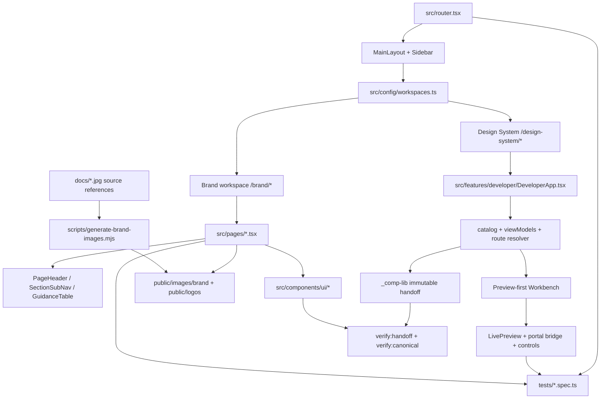

# Brand Kit repository context map

This is the fast orientation map for maintainers and handoff agents. It records
relationships and ownership boundaries rather than duplicating implementation
details. Update it whenever a workspace, canonical source, shared host pattern,
route family, asset pipeline, or completion test changes.

## System topology

## Workspace and route authority

| Concern | Authority | Notes |
|---|---|---|
| Workspace IDs, labels, navigation and remembered routes | `src/config/workspaces.ts` | Add a canonical page here as well as in the router. Dynamic Design System memory is validated against `_comp-lib/catalog/catalog.json`, not a permissive URL pattern. |
| Route components and legacy redirects | `src/router.tsx` | Brand routes are explicit; catalogue detail routes resolve inside `DeveloperApp`. |
| Shared application shell, focus handoff and responsive drawer | `src/components/layout/MainLayout.tsx` | Brand and Design System share one shell. |
| Sidebar workspace switcher and navigation | `src/components/layout/Sidebar.tsx` | Driven entirely by workspace config. |
| Brand pages | `src/pages/*.tsx` | Authored guidance and expression; may compose canonical UI. |
| Design System pages | `src/features/developer/pages/*` | Derived from maintained catalogue/view models. |
| Manual component review | `src/features/review/*` | Personal browser state; 45-entry sequential queue. |

## Component ownership boundary

- `_comp-lib/` is the immutable `scudamores-ui` 0.1.0 handoff. Never edit it to
  fix the host application.
- `src/components/ui/` contains exact canonical copies unless a file is an
  explicitly classified host adapter. `scripts/canonical-copies.json` and
  `npm run verify:canonical` enforce the boundary.
- `src/components/shared/` and `src/components/layout/` contain host patterns
  shared across workspaces. They are not copyable library components without a
  separate promotion review.
- Brand colours, photography, logo canvases and expressive compositions belong
  at Brand call sites. They must not silently redefine software semantic roles.
- The existing Design System serves software and internal tooling. Website
  expression is explored in the Brand workspace until stable website patterns
  justify a separately governed system.

## Brand workspace map

| Area | Route | Page source |
|---|---|---|
| Overview | `/brand` | `src/pages/Overview.tsx` |
| Quick Reference | `/brand/quick-reference` | `src/pages/QuickReference.tsx` |
| Logo | `/brand/identity/logo` | `src/pages/Logo.tsx` |
| Colour | `/brand/identity/colour` | `src/pages/Colour.tsx` |
| Typography | `/brand/identity/typography` | `src/pages/Typography.tsx` |
| Voice | `/brand/expression/voice` | `src/pages/Voice.tsx` |
| Photography | `/brand/expression/photography` | `src/pages/Photography.tsx` |
| Graphics | `/brand/expression/graphics` | `src/pages/Graphics.tsx` |
| Applications | `/brand/applications` | `src/pages/Applications.tsx` |
| Resources | `/brand/resources` | `src/pages/Downloads.tsx` |
| Brand Playground | `/brand/expression/playground` | `src/pages/BrandPlayground.tsx` and `src/features/brand-playground/*` |

Quick Reference is generated from the locked identity anchors, approved
typography, and the current local Brand Playground draft. It must not grow a
second static token inventory.

Colour sources contextual expression families from
`src/features/brand-playground/palette.ts`. Deep Navy/Off-White stay locked;
`src/lib/tokens.ts`, `src/index.css`, and `src/pages/Downloads.tsx` carry the
Water Powder/Faded Butter supporting ramps. Mood Explorer loads explicit
recipes into the same persisted Playground draft rather than maintaining a
parallel theme state. The live contrast checker and Brand command search draw
from these current sources; Lantern Gold exists only in historical Theme
comparisons and must not be reintroduced into runtime Brand tokens.

## Design System data flow

1. `_comp-lib/catalog/catalog.json` and maintained handoff sources define the
   inventory and source contracts.
2. `src/features/developer/catalog/*` imports, validates and searches that data.
3. `src/features/developer/viewModels.ts` builds page-ready models.
4. `src/features/developer/DeveloperApp.tsx` resolves collection/detail routes.
5. Page components render the preview-first workbench, documentation sheet and
   exact React/Blade source actions.
6. `src/features/developer/preview/*` owns scoped themes, widths, directions,
   manifest states and preview portals.

## Photography asset flow

- Source references remain in `docs/`:
  `Hero_portrait.jpg` and `kings_private_1.jpg`.
- `npm run generate:brand-images` creates optimized, reproducible derivatives
  under `public/images/brand/heroes/` using the Playwright already installed in
  the repository. It performs no network access or package installation.
- Photography guidance uses the pair as clearly labelled shared placeholders.
  Every product still requires its own final approved master.
- The Brand Playground uses art direction: landscape for wide previews and the
  dedicated portrait image for narrow previews. Do not simulate the portrait
  by cropping the landscape source.

## Completion evidence map

| Requirement | Principal evidence |
|---|---|
| Workspace switching, memory, redirects and mobile drawer | `tests/workspace.shell.spec.ts` |
| Brand framing, controls, tables, charts and focus | `tests/brandkit.migration.spec.ts` |
| Brand/Design routes, responsive overflow and axe | `tests/brandkit.routes.spec.ts` |
| Brand Playground, saved/exported state and Photography placeholders | `tests/brand-playground.spec.ts` |
| Colour recipes, Mood Explorer handoff and route-bottom scroll containment | `tests/brandkit.migration.spec.ts` and `tests/workspace.shell.spec.ts` |
| Opt-in route contact sheet for human review | `npm run audit:brand:visual` using `playwright.brand-audit.config.ts` |
| Component collection list/card/search | `tests/component.collection.spec.ts` |
| Preview-first workbench and exact source actions | `tests/design-system.workbench.spec.ts` |
| Calendar intrinsic width | `tests/calendar.preview.spec.ts` |
| All catalogue routes and inventory states | `tests/developer.routes.spec.ts` |
| Component/recipe behaviour and callbacks | `tests/developer.interactions.spec.ts` and `tests/developer.behaviour.spec.ts` |
| Scoped portals | `tests/developer.portals.spec.ts` |
| Full catalogue WCAG sweep | `tests/developer.a11y.spec.ts` |
| Visual baselines | `tests/developer.visual.spec.ts` |
| 45-entry manual review workflow | `tests/preview-review.spec.ts` |
| Built SPA root and deep link | `tests/production.smoke.ts` |

Run browser suites serially with one worker in the 2-core Codespace.

The final human gates are the 45-entry queue at
`/design-system/review/previews`, a live Brand route pass, and selection of a
saved Playground treatment. Automated evidence supports those reviews but does
not replace them.

## Change recipes

### Add a Brand page

1. Add the page or feature source.
2. Add its canonical route in `src/router.tsx`.
3. Add navigation metadata in `src/config/workspaces.ts`.
4. Add command-search coverage if the workspace search does not derive it.
5. Extend responsive/accessibility route evidence.
6. Update this map and `handoff.md`.

### Add or promote a copyable component

1. Start from reviewed original React and Blade source plus behaviour contracts.
2. Update the immutable handoff only through a separately authorised handoff
   release process.
3. Copy the approved file into the destination and classify it in
   `scripts/canonical-copies.json`.
4. Extend catalogue data, preview registration and interaction/a11y evidence.

### Add Brand photography

1. Preserve the supplied master as a source reference.
2. Add deterministic derivative definitions to the image-generation script.
3. Use `<picture>`, `srcSet`, `sizes`, lazy loading and meaningful art direction.
4. Document crop, subject, rights and replacement status in Photography.
